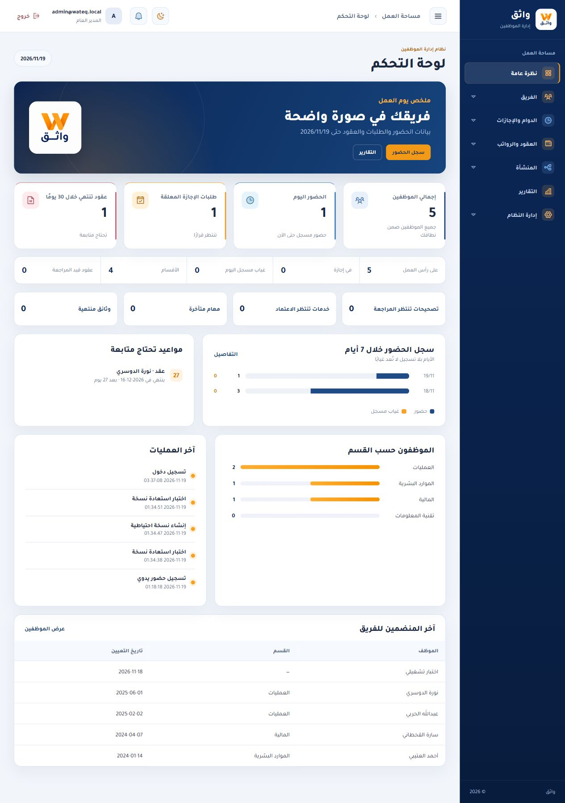
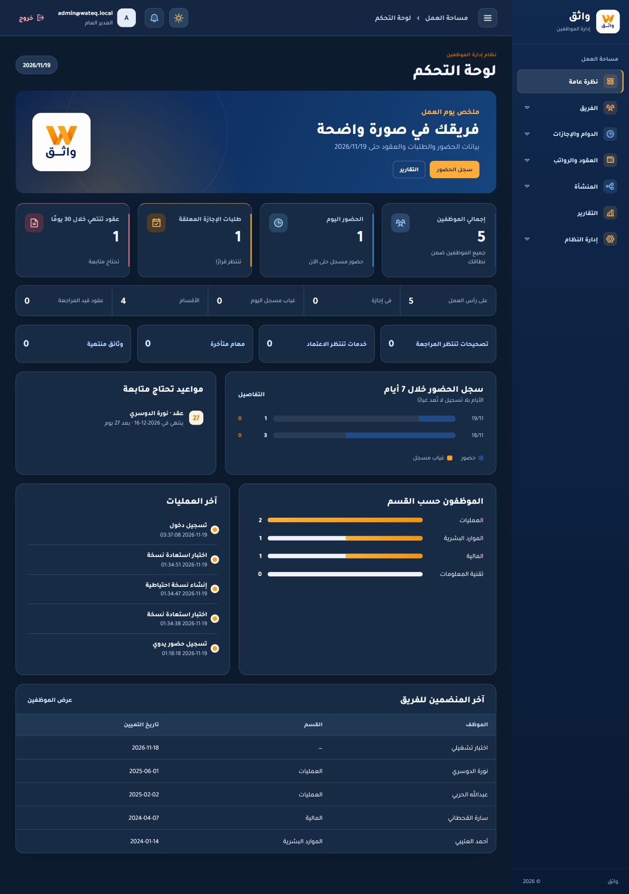

# واثق — نظام إدارة الموظفين

نظام عربي RTL مبني بـ PHP 8.2+ وMySQL 8 وPDO. يستخدم شعار واثق وخط Tajawal المرفقين، وواجهة متجاوبة ذات وضع ليلي. صُمّم للعمل من مجلد `public` فقط؛ الإعدادات والملفات المرفوعة خارج جذر الويب.

## صور من النظام

| لوحة التحكم النهارية كاملة | لوحة التحكم الليلية كاملة |
|---|---|
|  |  |


## المتطلبات

- PHP 8.2 أو أحدث مع إضافات `pdo_mysql` و`fileinfo` و`openssl`.
- MySQL 8 أو إصدار متوافق من MariaDB.
- متصفح حديث. تُحمّل Bootstrap 5 RTL من jsDelivr، مع تنسيق محلي أساسي يعمل إذا تعذر الوصول إلى CDN.
- أيقونات Phosphor Duotone 2.1.2 مخزنة محليًا في `public/assets/icons/phosphor-duotone` مع ترخيص MIT الخاص بها، وتعمل دون اتصال خارجي. ألوان الثيمين مضبوطة في `public/assets/theme.css`.
- XAMPP أو Laragon أو خادم PHP المدمج. يوصى بـ HTTPS عند النشر.

## إعداد قاعدة البيانات

1. أنشئ قاعدة البيانات والجداول باستيراد [`database/schema.sql`](database/schema.sql) من phpMyAdmin أو MySQL CLI.
2. انسخ `.env.example` إلى `.env` في جذر المشروع، وعدّل `DB_HOST` و`DB_NAME` و`DB_USER` و`DB_PASS`. لا تضع `.env` داخل `public`.
3. شغّل ملف البيانات التجريبية مرة واحدة. كلمة المرور التي تمررها هي كلمة مرور الحسابات الأربعة التجريبية ويجب تغييرها بعد التجربة:

```powershell
$ext = Join-Path (Split-Path (Get-Command php).Source) 'ext'
php -d "extension_dir=$ext" -d extension=pdo_mysql -d extension=fileinfo bin/seed.php '<choose-a-strong-demo-password>'
```

عند استخدام PHP المرفق مع XAMPP أو Laragon وتفعيل الإضافات في `php.ini` يكفي: `php bin/seed.php '<choose-a-strong-demo-password>'`.

عند ترقية قاعدة بيانات أُنشئت بإصدار سابق، شغّل `bin/migrate.php` بعد تحديث الملفات. الأمر آمن للتكرار ويضيف أعمدة العقود وجدولي الإصدارات والتنبيهات:

```powershell
$ext = Join-Path (Split-Path (Get-Command php).Source) 'ext'
php -d "extension_dir=$ext" -d extension=pdo_mysql bin/migrate.php
```

## التشغيل

داخل هذا المشروع على Windows:

```powershell
powershell -ExecutionPolicy Bypass -File bin/run.ps1
```

ثم افتح [http://127.0.0.1:8000/?page=login](http://127.0.0.1:8000/?page=login). إذا كان المنفذ 8000 مستخدمًا، غيّره في `bin/run.ps1` وفي الرابط.

إذا استخدمت MySQL المحلي المرفق بالتجربة على Windows، شغّل `bin/run_mysql.ps1` قبل خادم PHP بعد إعداد مسار البيانات محليًا. لا ترفع `.env` أو ملفات قاعدة البيانات والنسخ الاحتياطية.

في XAMPP أو Laragon، اضبط DocumentRoot أو Virtual Host على المجلد `public`، ثم فعّل `pdo_mysql` و`fileinfo` في `php.ini`. لا تجعل جذر المشروع كله عامًا.

## حسابات التجربة

| الدور | البريد | كلمة المرور |
|---|---|---|
| المدير العام | `admin@wateq.local` | القيمة التي تمررها لأمر البذر |
| الموارد البشرية | `hr@wateq.local` | القيمة التي تمررها لأمر البذر |
| المشرف | `supervisor@wateq.local` | القيمة التي تمررها لأمر البذر |
| الموظف | `employee@wateq.local` | القيمة التي تمررها لأمر البذر |

يُعيد تشغيل `bin/seed.php` تعيين كلمات مرور هذه الحسابات إلى القيمة الممررة. لا تستخدم البيانات التجريبية في الإنتاج.

## الوظائف

- تسجيل دخول بجلسة تنتهي بعد 30 دقيقة خمول، حد محاولات فاشلة، CSRF، صلاحيات حسب الدور، وتغيير كلمة المرور.
- إدارة الموظفين والأقسام والفروع والمسميات والدرجات والورديات، مع بحث وتصفية وترقيم صفحات.
- حضور وانصراف ذاتي وتسجيل يدوي؛ يمنع قيدًا ثانيًا لليوم نفسه. يحسب التأخير والانصراف المبكر والإضافي حسب الوردية.
- طلبات إجازة وموافقات أولية للمشرف وقرار نهائي للمدير أو الموارد البشرية، مع خصم الرصيد داخل معاملة قاعدة بيانات. يمكن تحديد احتساب كل نوع بالأيام التقويمية أو أيام العمل، وفق وردية الموظف والعطل المسجلة.
- تقويم شهري للموظف يعرض أيام العمل والراحة والعطل والإجازات والحضور، مع تعيين الورديات بتاريخ سريان وإدارة عطل عامة أو خاصة بفرع.
- عقود ووثائق ورواتب وتقييم أداء وتدريب، وتنزيل الملفات عبر صلاحيات دون إتاحتها مباشرة.
- دورة اعتماد العقود: مسودة، مراجعة من مستخدم آخر، إصدار معتمد محفوظ ببياناته وشروطه وتاريخ اعتماده.
- ملف موحّد للموظف يجمع العقود والوثائق والحضور والإجازات والقسائم والتقييمات وتسلسلًا زمنيًا، مع ضبط الوصول بحسب الصلاحية.
- لوحة تحكم بحسب الدور تعرض الحضور والطلبات والتنبيهات، وتقارير CSV متوافقة مع Excel.
- تقارير مقارنة شهرية للحضور وحركة الموظفين، وفلاتر للفترة والقسم والفرع، وسجل نشاط يبيّن المستخدم والإجراء والحقول المتغيرة.
- كليشة موحدة للعقود والتقارير تحمل الشعار وبيانات المنشأة، وتدعم الطباعة أو حفظ PDF من المتصفح.
- تنبيهات انتهاء العقود والوثائق داخل النظام، وبريد اختياري عند ضبط خادم البريد، ونسخ SQL يومية داخل `storage/backups`.
- طلب تصحيح حضور بمراجعة المشرف أو الموارد البشرية، وتطبيق الوقت المعتمد على سجل الحضور مع حفظ قرار المراجع.
- خدمة ذاتية لطلب خطاب تعريف بالراتب أو شهادة خبرة أو تحديث بيانات التواصل، مع اعتماد الخطابات وحفظ نسخة ثابتة من بياناتها.
- دورة رواتب من مسودة إلى مراجعة واعتماد من مستخدم آخر ثم تأكيد الصرف وقفل الشهر؛ لا تُعدّل السجلات بعد إرسالها للمراجعة.
- مهام تعيين ومغادرة أساسية تُنشأ تلقائيًا عند إضافة الموظف أو إنهاء خدمته، مع مهام إضافية وتواريخ استحقاق.
- قواعد تنبيه قابلة لضبط التوقيت والمستلمين للعقود والوثائق وشهادات التدريب، ومؤشرات للطلبات والمهام المتأخرة على لوحة التحكم.
- تحقق إضافي اختياري برمز تطبيق مصادقة ورموز استعادة أحادية الاستخدام، واستعادة كلمة المرور عبر بريد مهيأ.
- اختبار استعادة نسخ SQL في قاعدة مؤقتة مع مقارنة عدد سجلات كل جدول وتسجيل النتيجة.

لإثبات الغياب تلقائيًا عن يوم عمل سابق، شغّل دوريًا بعد نهاية اليوم:

```powershell
php bin/mark_absences.php 2026-11-17
```

يعتمد الأمر على أيام العمل في وردية كل موظف، أو `work_days` في الإعدادات عند عدم تحديدها للوردية، ويتجاوز العطل المسجلة ومن له حضور أو إجازة مقبولة. يمكن جدولة الأمر يوميًا عبر Windows Task Scheduler أو cron. على بيئة PHP الحالية استخدم خيارات الإضافات نفسها الموضحة أعلاه.

## إضافة مستخدم

سجّل دخول المدير العام، ثم افتح **المستخدمون**، أدخل البريد والدور واربط الحساب بموظف عند الحاجة. يجب أن تحتوي كلمة المرور على 12 حرفًا على الأقل وحرف كبير ورقم. يستطيع المستخدم تغييرها من صفحة **تغيير كلمة المرور**.

## كليشة العقود والتقارير

من **الإعدادات** حدّد اسم المنشأة وعنوانها ووسائل التواصل، وعدّل **نص كليشة العقود** و**تذييل التقارير**. يظهر الشعار المرفق وخط Tajawal تلقائيًا. افتح عقدًا من **العقود** ثم اضغط **عرض كليشة العقد**، أو اختر **طباعة** من قائمة العقود. يستطيع الموظف عرض عقده من **ملفي الشخصي**. تحتوي الكليشة على بيانات العقد والموظف ومساحتي توقيع؛ راجع الشروط قانونيًا قبل اعتماد أي عقد. من **التقارير** اختر التقرير ثم اضغط **طباعة / حفظ PDF**. تُضبط الورقة على A4 في أنماط الطباعة.

للاعتماد، افتح العقد وأرسله للمراجعة. يجب أن يعتمد العقد مستخدم آخر لديه صلاحية إدارة العقود. تحفظ نسخة كل اعتماد في جدول الإصدارات؛ عند تعديل عقد معتمد تعود النسخة الجارية إلى مسودة ويبقى الإصدار السابق قابلًا للعرض. النسخة غير المعتمدة موسومة بوضوح. لا يمكن حذف عقد له إصدار معتمد.

## التنبيهات والتشغيل اليومي

تشغّل `bin/daily.php` تنبيهات انتهاء العقود والوثائق قبل 30 أو 7 أو يوم واحد، وفي يوم الانتهاء، مع منع التكرار. تُرسل إلى المدير والموارد البشرية وصاحب السجل داخل النظام. يكتب التشغيل نسخة SQL خاصة وسجلًا في `storage/logs/daily.log`. شغّلها يدويًا على Windows عبر:

```powershell
powershell -NoProfile -ExecutionPolicy Bypass -File bin/run_daily.ps1
```

لتسجيل مهمة يومية الساعة 01:00 للمستخدم الحالي، شغّل `bin/install_daily_task.ps1`. المهمة تعمل عندما يكون مستخدم Windows مسجل الدخول؛ يبدأ السكربت قاعدة MySQL المحلية إن كانت مهيأة بملف `storage/mysql-datadir.txt`. في الخادم استخدم cron لتشغيل `bin/daily.php` يوميًا، مع إعدادات PHP المناسبة.

البريد اختياري: اضبط `MAIL_ENABLED=1` و`MAIL_FROM` في `.env` بعد إعداد خدمة `mail()` على الخادم. تبقى التنبيهات داخل النظام فعالة دون بريد. لا تضبط الإرسال إلى عناوين حقيقية قبل اختبار إعدادات البريد في بيئة موثوقة.

لاستعادة كلمة المرور عبر البريد، اضبط أيضًا `APP_URL` بعنوان الموقع الثابت. فعّل التحقق الإضافي من **ملفي الشخصي ← التحقق الإضافي**، واحفظ رموز الاستعادة التي تظهر مرة واحدة بعد التفعيل.

## النسخ الاحتياطي والاستعادة

من **الإعدادات** اضغط **إنشاء نسخة الآن**. تحفظ النسخة في `storage/backups`. للاستعادة، استورد ملف SQL عبر MySQL CLI أو phpMyAdmin إلى قاعدة بيانات فارغة. احفظ النسخ خارج الخادم العام أيضًا.

لاختبار أحدث نسخة فعليًا، شغّل `php bin/verify_backup.php` مع تفعيل `pdo_mysql`. ينشئ الأمر قاعدة اختبار مؤقتة ويستورد النسخة ويقارن عدد سجلات الجداول ثم يحذف القاعدة المؤقتة. يلزم حساب MySQL يملك `CREATE DATABASE` و`DROP DATABASE` عبر `BACKUP_VERIFY_USER` و`BACKUP_VERIFY_PASS`، أو ملف اعتماد قاعدة البيانات المحلية. تشغّل المهمة اليومية الاختبار أسبوعيًا يوم الأحد إذا توفرت بيانات الاعتماد. يمكن ضبط مسار عميل MySQL عبر `MYSQL_CLI`.

لتشغيل فحص الصياغة واختبارات التشغيل والتكامل، مع تشغيل قاعدة البيانات المحلية، نفّذ `powershell -NoProfile -ExecutionPolicy Bypass -File bin/verify.ps1`.

## النشر على الاستضافة

ارفع الملفات، واجعل DocumentRoot يشير إلى `public`، وأنشئ قاعدة MySQL 8، ثم استورد المخطط واضبط `.env` خارج `public`. امنح `storage/uploads` و`storage/backups` صلاحية كتابة لخادم الويب، فعّل HTTPS واضبط إعدادات الكوكيز والجلسات، وأنشئ مستخدم مدير بكلمة قوية ثم احذف بيانات التجربة أو غيّرها. شغّل مهمة الغياب المجدولة إذا كنت تريد احتساب الغياب تلقائيًا.

## قرارات وحدود النسخة الحالية

- الطلبات القديمة تحتفظ بطريقة احتسابها السابقة. الطلبات الجديدة تستخدم طريقة الاحتساب المحددة لنوع الإجازة عند تقديمها، وتحفظ تفصيل الأيام لكل سنة لضمان ثبات الرصيد عند الموافقة.
- تصدير PDF يتم من نافذة الطباعة في المتصفح، وليس عبر مولّد PDF على الخادم. تصدير Excel بصيغة CSV UTF-8.
- استعادة كلمة المرور الذاتية تحتاج خدمة بريد موثوقة؛ إدارة الحسابات وتغيير كلمة المرور متاحان حاليًا.
- الإرسال البريدي يعتمد على تهيئة `mail()` في PHP؛ البيئة المحلية الحالية لم تُهيأ لإرسال البريد، لذا جرى اختبار التنبيهات الداخلية فقط.
- تقرير المغادرات يعتمد على تاريخ تغيير الحالة المسجل بعد هذه الترقية؛ السجلات القديمة التي لم تحفظ تاريخ المغادرة تحتاج إدخالًا يدويًا عند ترحيلها.
- لا توجد بوابة دفع أو ربط بنكي؛ الرواتب سجلات داخلية.
- اختُبرت عمليات الاعتماد بمستخدمين مختلفين، وثبات الإصدار المعتمد، ومنع تكرار التنبيه، وصلاحيات ملف الموظف، ورسوم التقارير في قاعدة البيانات المحلية. جرى فحص الواجهة بصريًا على صفحات العقود والتقارير والملف الموحّد.

## شجرة المشروع

```text
app/             المنطق، المصادقة، تعريف الوحدات، الواجهات
bin/             تشغيل محلي، بيانات تجريبية، تسجيل الغياب
config/          إعدادات التطبيق وقاعدة البيانات
database/        schema.sql و seed.sql
public/          نقطة الدخول، CSS، JavaScript، الشعار، الخط
storage/         الملفات الخاصة والسجلات والنسخ الاحتياطية
.env.example     نموذج الإعداد المحلي
README.md        دليل التشغيل
```
